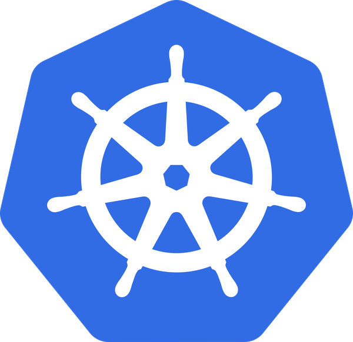
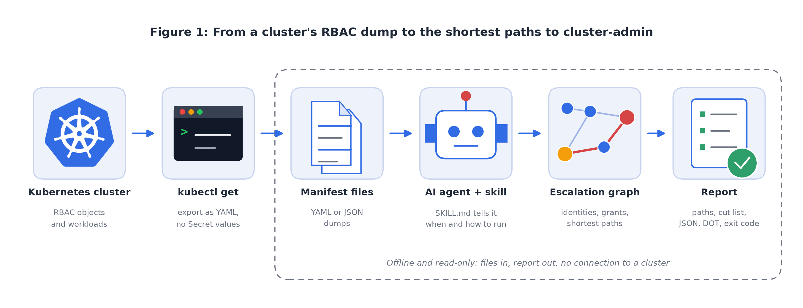

<div align="center">



# Kubernetes Cluster-Admin Escalation Mapper

**Linters tell you a role is risky. This tells you where it leads.**

</div>

## Contents

1. [Overview](#overview)
2. [Key Features](#key-features)
3. [System Architecture](#system-architecture)
4. [Tech Stack](#tech-stack)
5. [Setup Instructions](#setup-instructions)
6. [Usage Guide](#usage-guide)
7. [Testing](#testing)
8. [License](#license)

## Overview

This is an open-source Claude skill, with a standalone Python CLI behind it, that maps chained RBAC paths from any Kubernetes identity to cluster-admin. Most RBAC checkers look at one role at a time and flag verbs like `*`, `secrets` or `pods/exec`. Real escalations are chains of grants that each look ordinary: a namespace admin writes a custom resource, the operator behind it can create Jobs in `kube-system`, and a Job there runs as a deploy bot that holds `*` on `*`. No single role in that chain is cluster-admin, so a per-role linter stays quiet.

The tool follows permission chains step by step across roles, bindings, service accounts, namespaces and workloads. For every identity that is not already an admin, it prints the shortest chain to cluster-admin and explains each hop. It then lists a small set of grants to remove to break the most paths at once (greedy algorithm).

It is read-only and offline. It parses files you give it and never connects to a cluster. The skill (`SKILL.md`) and the CLI (`scripts/escalation_map.py`) share one engine, and the CLI needs nothing beyond Python's standard library.

## Key Features

- **Chained hops.** Models bind and escalate, impersonation, pod and workload creation, `pods/exec`, attach and ephemeral containers, secret read and create, `serviceaccounts/token`, `nodes/proxy`, mutating webhooks, the EKS `aws-auth` ConfigMap, and workload-to-node escapes. CSR create+approve is reported as a standing exposure (not a complete path on Kubernetes 1.22+).
- **Shortest chain per identity.** Each path names the ClusterRole or Role and the binding behind every hop.
- **Cut list.** Starts with the grant whose removal breaks the most paths, then repeats on what is left.
- **Standing exposures.** Dangerous grants that do not finish a path with the data given, such as validating webhook writes or aggregated roles that expose secrets.
- **Real RBAC semantics.** Aggregated ClusterRoles are expanded, RoleBindings stay scoped to their namespace, `resourceNames` pins are respected, and group inheritance works.
- **Confidence labels.** Hops that rest on an assumption are marked `[likely]`; the operator confused-deputy rule is marked `[heuristic]`.
- **Several output modes.** Text report, `--json`, `--dot` for Graphviz, and `--html` for an interactive D3 graph in one offline file.
- **CI-friendly exit codes.** `0` clean, `1` a path at or above `--fail-on`, `2` bad input.
- **Offline and read-only.** No cluster credentials and no network calls.

## System Architecture

<p align="center">
  
</p>
<p align="center"><em>Figure 1. From a cluster's RBAC dump to the shortest paths to cluster-admin.</em></p>

How a run flows, left to right:

1. **Cluster.** The cluster holds the RBAC objects (ClusterRoles, Roles, bindings, service accounts) and the workloads that use them.
2. **kubectl export.** You run `kubectl get ... -o yaml` with read access to those object types. Secret values are not needed and should not be exported.
3. **Manifest files.** The result is one or more YAML or JSON files. Helm-rendered output and plain manifests from a Git repo work too, so you can check a change before it is applied.
4. **Agent and skill.** The agent loads `SKILL.md`, which tells it when the tool applies and how to run and report it. Or you skip the agent and call the CLI directly.
5. **Permission chains.** The tool follows permission chains step by step across identities, grants, workloads and node-root capabilities, and reports the shortest chain from each identity to cluster-admin.
6. **Report.** You get each path hop by hop, a cut list, standing exposures, caveats, and an exit code. Steps 4 to 6 run on your machine against files only.

## Tech Stack

| Layer | What is used |
| --- | --- |
| Target platform | Kubernetes RBAC (rbac.authorization.k8s.io/v1), Pod Security Admission labels |
| Input | `kubectl get -o yaml` or `-o json`, Helm-rendered manifests, plain YAML/JSON files |
| Engine | Python 3.9 or newer, standard library only; a small built-in YAML loader, so PyYAML is not required |
| Search | Follows permission chains step by step, reports the shortest chain to cluster-admin, and lists a small set of grants to remove (greedy) |
| Output | Text, JSON, Graphviz DOT, self-contained interactive HTML |
| Agent integration | `SKILL.md` with YAML frontmatter, loaded by Claude Code and compatible agents |
| Graph page | [D3.js](https://d3js.org) v7, vendored as `scripts/d3.v7.min.js` and inlined into the `--html` file |
| Optional | Graphviz (`dot`) to render the DOT output |
| Docs and tests | matplotlib (Figure 1), D3.js and headless Chromium via Playwright (Figure 2 and `tests/render_check.py`) |

## Setup Instructions

### 1. Check Python

```bash
python3 --version   # 3.9 or newer
```

### 2. Get the code

```bash
git clone https://github.com/ritvikindupuri/k8s-cluster-admin-escalation-mapper.git
cd k8s-cluster-admin-escalation-mapper
python3 scripts/escalation_map.py --help
```

### 3. Install it as a Claude skill (optional)

For all your projects:

```bash
mkdir -p ~/.claude/skills
cp -r "$(pwd)" ~/.claude/skills/k8s-cluster-admin-escalation-mapper
```

For one project only:

```bash
mkdir -p .claude/skills
cp -r /path/to/k8s-cluster-admin-escalation-mapper .claude/skills/
```

The skill is `SKILL.md` plus the `scripts/` folder. `graph_template.html` and `d3.v7.min.js` in `scripts/` are only needed for `--html`. Other agents that read `SKILL.md` files can use the same folder in their own skills directory. Start a new agent session afterwards so it picks the skill up.

### 4. Export the input from your cluster

You need a kubeconfig with read access to RBAC objects:

```bash
kubectl get clusterroles,clusterrolebindings,roles,rolebindings,serviceaccounts,namespaces -A -o yaml > rbac.yaml
kubectl get deploy,sts,ds,job,cronjob,pod -A -o yaml > workloads.yaml
```

Notes on the input:

- Export the workloads too. Without them the tool cannot tell which service accounts are in use, which pods are privileged, or what `pods/exec` and `nodes/proxy` would land on.
- `secrets` is left out on purpose. If you want the tool to know which service accounts have long-lived token secrets, give it a trimmed list that keeps only `kind`, `type`, `metadata.name`, `metadata.namespace` and the `kubernetes.io/service-account.name` annotation.
- Manifests that are not deployed yet work too, for example `helm template ... > rendered.yaml`. Files that still contain `{{ }}` templating are skipped with a warning, so render them first.

### 5. Check the install on a bundled example

```bash
python3 scripts/escalation_map.py examples/keda-style --psa-exempt-ns kube-system
```

This should report two paths and exit with code `1`. The expected output is in [SAMPLE_OUTPUT.md](SAMPLE_OUTPUT.md#keda-style).

## Usage Guide

### Step 1. Use it as a Claude skill

1. Install the skill (Setup, step 3) and start a new Claude Code session.
2. Put `rbac.yaml` and `workloads.yaml` somewhere the agent can read them.
3. Describe the job in plain words. Prompts that trigger the skill:
   - "Here is `rbac.yaml` and `workloads.yaml`. Who can really become cluster-admin in this cluster?"
   - "We run a multi-tenant cluster. Can a namespace admin in `tenant-a` get to cluster-admin?"
   - "Check whether the `monitoring` service account can escalate. Start from `SA:monitoring/`."
   - "Do any operator service accounts chain into cluster-admin? Include the pods too."
   - "Review this Helm render for RBAC escalation paths before we merge it."
4. The agent runs the script and reports each path from start to end, the hops in order with the grant behind each one, and the one change that breaks it. It is told not to paste secret values and to say what the input did not include.

### Step 2. Run the script directly

```bash
python3 scripts/escalation_map.py [paths ...] [options]
```

`paths` can be files, directories (read recursively for YAML and JSON), `-` for stdin, or a mix.

Common runs:

```bash
python3 scripts/escalation_map.py rbac.yaml workloads.yaml
python3 scripts/escalation_map.py dump/ --from SA:payments/ci
python3 scripts/escalation_map.py dump/ --pods
python3 scripts/escalation_map.py dump/ --psa-exempt-ns kube-system,monitoring
kubectl get clusterroles,clusterrolebindings,roles,rolebindings,serviceaccounts,namespaces -A -o yaml | python3 scripts/escalation_map.py -
```

### Step 3. Pick the options you need

| Option | What it does |
| --- | --- |
| `--from TEXT` | Only report paths that start at identities whose key contains `TEXT`, for example `SA:payments/ci` or `Group:tenant-a` |
| `--pods` | Also report "if this workload is popped" paths for every workload |
| `--include-system` | Include `system:*` identities as starting points (hidden by default) |
| `--eks` | Consider the `aws-auth` ConfigMap hop even if the input shows no signs of EKS |
| `--psa-exempt-ns a,b` | Namespaces exempt from Pod Security Admission, so pod-create there counts as node root |
| `--assume-control-plane` | Treat root on any node as cluster-admin. Only for self-managed clusters where a pod can be pinned to a control-plane node |
| `--no-heuristics` | Turn off the operator confused-deputy rule |
| `--fail-on {critical,high,medium,low}` | Lowest severity that makes the exit code `1` (default `high`) |
| `--json` | Machine-readable output |
| `--dot` | Union of reported paths as Graphviz DOT |
| `--html OUT.html` | Also write an interactive graph of the reported paths as one self-contained HTML file |
| `--list-admins` | List cluster-admin-equivalent identities |

### Step 4. Choose an output mode

- **Text (default).** The report for people: paths, cut list, exposures, caveats.
- **`--json`** for dashboards and ticketing. The JSON has `summary`, `paths`, `cut_list`, `exposures` and `notes`.

  ```bash
  python3 scripts/escalation_map.py manifests/ --json > paths.json
  ```

- **`--dot`** for Graphviz. Needs `dot` installed.

  ```bash
  python3 scripts/escalation_map.py dump/ --dot | dot -Tsvg > paths.svg
  ```

- **`--html`** for an interactive graph. Open the file in any browser; it needs no server and no internet connection.

  ```bash
  python3 scripts/escalation_map.py rbac.yaml workloads.yaml --html paths.html
  ```

See [SAMPLE_OUTPUT.md](SAMPLE_OUTPUT.md) for full example output in every mode, including the graph figures.

### Step 5. Use the interactive graph

1. **Columns.** Start identities sit on the left. Each column to the right is one more step, and cluster-admin is always the last column.
2. **Cards.** Colour and icon show the type: group, user, service account, workload, root on a node, and the cluster-admin goal. Start cards carry a severity badge. Long names are shortened on the card and shown in full in the tooltip.
3. **Arrows.** Solid means the hop is certain from the files given. Dashed means it rests on an assumption. Dotted means the operator confused-deputy heuristic, so check it by hand. Arrows into cluster-admin are red.
4. **Hover an arrow** to see what the attacker does, why the grant allows it, the role and binding behind it, the confidence level, and the change that removes the hop.
5. **Hover a card** to highlight everything downstream of it and dim the rest.
6. **Drag a card** to rearrange it, scroll to zoom, drag the background to pan, and double-click the background to reset the view.
7. **Dense graphs.** A label with no clear space is hidden and the footer says how many; hover that arrow to read it.
8. **No paths.** If nothing reaches cluster-admin the page says so.

The page contains identity and grant names from your input, so handle it like the text report.

### Step 6. Read the report

- **Severity.** CRITICAL means the chain starts at anyone without credentials, any authenticated identity, or any service account. HIGH means one specific identity.
- **Each hop** shows `from -> to`, the action in plain words, why the grant allows it, and which role and binding supplies it.
- **`[likely]`** marks a hop that depends on an assumption the tool states, such as no Pod Security label being visible.
- **`[heuristic]`** marks the operator confused-deputy rule. Read that operator's handling of the custom resource before treating it as a finding.
- **Standing exposures** are dangerous grants that do not complete a path in the data given.
- **Caveats** list what was not modelled, so a clean result is not proof.

### Step 7. Apply the cut list

The cut list picks the grant that removes the most remaining paths, then repeats on what is left. In the `keda-style` example, removing pod-create from the operator's ClusterRole closes both paths.

1. Remove the first grant on the list.
2. Re-export the RBAC objects.
3. Run the tool again.
4. Repeat until it reports no paths.

The tool reports the shortest chain for each identity, not every possible chain, so a second route through different grants can sit behind the one shown.

### Step 8. Use it in CI

Check manifests in a pull request, before they reach a cluster:

```yaml
# GitHub Actions example
- name: RBAC escalation check
  run: |
    python3 tools/escalation_map.py manifests/ --fail-on high --psa-exempt-ns kube-system
```

### Exit codes

| Code | Meaning |
| --- | --- |
| `0` | No path at or above `--fail-on` |
| `1` | At least one path at or above `--fail-on` (default `high`) |
| `2` | The input could not be parsed, for example no RBAC objects found. You may want to treat this as a failure in CI too |

### Limits

- **Static analysis of what you give it.** A partial dump only shows the chains visible in that data.
- **Policy engines are not evaluated.** Kyverno, Gatekeeper and ValidatingAdmissionPolicy may already block a hop. The tool prints a note when it sees their objects.
- **Not modelled:** kubelet reachability, whether the control plane is schedulable, cloud IAM, and in-cluster authenticators other than RBAC.
- **Shortest chain, not every chain.** Rerun after fixing.
- **It cannot confirm a hop works**, only that RBAC permits it. Do not test hops on a cluster you do not own or are not authorized to test.

The bundled fixtures in [`examples/`](examples/) are invented, inert YAML. Do not apply them to a cluster.

## Testing

The test report (live kind cluster, bundled fixtures, HTML graph rendering) is in [TESTING.md](TESTING.md).

## License

MIT. See [LICENSE](LICENSE).
