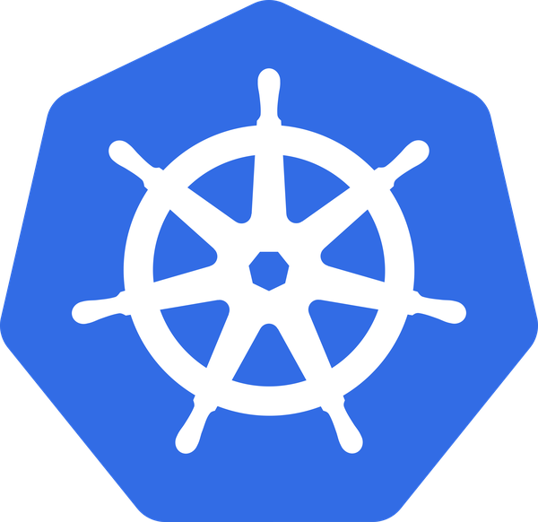
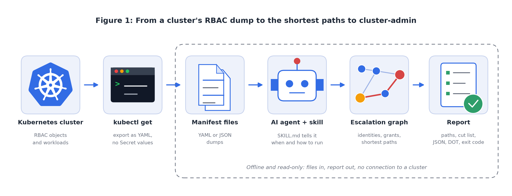

<div align="center">



# Kubernetes Cluster-Admin Escalation Mapper

**Linters tell you a role is risky. This tells you where it leads.**

An agent skill and a standalone Python CLI that maps chained RBAC paths from any identity to cluster-admin.

</div>

---

## Overview

Most Kubernetes RBAC checkers look at one role at a time and flag the scary verbs: `*`, `secrets`, `pods/exec`. That is useful, but it misses how clusters actually get taken over. Real escalations are chains of grants that each look ordinary on their own:

- A namespace admin can create custom resources for an operator.
- That operator's service account can create Jobs in `kube-system`.
- A Job in `kube-system` can run as a deploy bot that already holds `*` on `*`.

No single role in that chain is "cluster-admin", so a per-role linter stays quiet. The chain still ends there.

This project puts roles, bindings, service accounts, namespaces and workloads into one graph and searches it. For every identity that is not already an admin it prints the shortest chain to cluster-admin, explains each hop (what the grant allows and why it matters), and then gives the smallest set of grants to remove to break the most paths at once.

It ships in two forms that share the same engine:

1. **An agent skill** (`SKILL.md`) for Claude Code and other agents that read the `SKILL.md` format. You ask "who can really become cluster-admin here?" and the agent runs the tool and reports the result.
2. **A plain CLI** (`scripts/escalation_map.py`) with no dependencies beyond Python's standard library, usable from a terminal or CI.

It is read-only and fully offline. It parses files you give it and never connects to a cluster.

## Key Features

- **Chained hops, not single findings.** Models bind and escalate, impersonation, pod and workload creation, `pods/exec`, attach and ephemeral containers, secret read and create, `serviceaccounts/token`, `nodes/proxy`, CSR approval, mutating webhooks, the EKS `aws-auth` ConfigMap, and workload-to-node escapes (privileged, hostPID, sensitive hostPath, dangerous capabilities).
- **Shortest path per identity.** Each non-admin identity gets the shortest chain to cluster-admin, with the exact ClusterRole/Role and binding that grants each hop.
- **Cut list.** A greedy cover picks the single grant whose removal breaks the most paths, then repeats. Usually this is a much smaller change than fixing paths one at a time.
- **Standing exposures.** Grants that are dangerous but do not finish a path with the data you gave it, such as write access to validating webhooks or APIServices, or aggregated roles that quietly hand every `edit` holder access to secrets.
- **Real RBAC semantics.** Aggregated ClusterRoles are expanded, RoleBindings to ClusterRoles stay scoped to their namespace, `resourceNames` pins are respected, and group inheritance works (`system:authenticated`, `system:unauthenticated`, `system:serviceaccounts`, per-namespace groups).
- **Honest confidence labels.** Hops resting on an assumption are marked `[likely]`; the operator confused-deputy rule is marked `[heuristic]` and can be switched off with `--no-heuristics`.
- **Output for people and pipelines.** Human-readable report, `--json`, and `--dot` for Graphviz.
- **CI-friendly exit codes.** `0` clean, `1` a path at or above `--fail-on`, `2` bad input.
- **Offline and read-only.** Standard library only, no cluster credentials, no network calls.

## System Architecture

<p align="center">
  
</p>

<p align="center"><b>Figure 1: From a cluster's RBAC dump to the shortest paths to cluster-admin</b></p>

How a run flows, left to right:

1. **Cluster.** The Kubernetes cluster holds the RBAC objects (ClusterRoles, Roles, bindings, service accounts) and the workloads that use them.
2. **kubectl export.** You run `kubectl get ... -o yaml` with read access to those object types. Secret values are not needed and should not be exported.
3. **Manifest files.** The result is one or more YAML or JSON files. Helm-rendered output and plain manifests from a Git repo work too, so you can check a change before it is applied.
4. **Agent and skill.** The agent loads `SKILL.md`, which tells it when this tool applies and how to run and report it. Or you skip the agent and call the CLI directly.
5. **Escalation graph.** The tool builds a graph of identities, grants, workloads and node-root capabilities, then searches it for the shortest route from each identity to cluster-admin.
6. **Report.** You get each path hop by hop, a cut list, standing exposures, caveats, and an exit code. Steps 4 to 6 run on your machine against files only.

## Tech Stack

| Layer | What is used |
| --- | --- |
| Target platform | Kubernetes RBAC (rbac.authorization.k8s.io/v1), Pod Security Admission labels |
| Input | `kubectl get -o yaml` or `-o json`, Helm-rendered manifests, plain YAML/JSON files |
| Engine | Python 3.9 or newer, standard library only; a small built-in YAML loader, so PyYAML is not required |
| Search | Directed graph with Dijkstra-style shortest paths and a greedy set cover for the cut list |
| Output | Text, JSON, Graphviz DOT |
| Agent integration | `SKILL.md` with YAML frontmatter, loaded by Claude Code and compatible agents |
| Optional | Graphviz (`dot`) to render the DOT output |
| Docs only | matplotlib to regenerate Figure 1 (`assets/build_diagram.py`); the Kubernetes logo is from the [kubernetes/kubernetes](https://github.com/kubernetes/kubernetes/tree/master/logo) repository |

## Setup Instructions

### 1. Check Python

```bash
python3 --version   # 3.9 or newer
```

### 2. Get the code

```bash
git clone https://github.com/ritvikindupuri/k8s-cluster-admin-escalation-mapper.git
cd k8s-cluster-admin-escalation-mapper
python3 scripts/escalation_map.py --help
```

### 3. Install it as an agent skill (optional)

Claude Code, for all your projects:

```bash
mkdir -p ~/.claude/skills
cp -r "$(pwd)" ~/.claude/skills/k8s-cluster-admin-escalation-mapper
```

Claude Code, for one project only:

```bash
mkdir -p .claude/skills
cp -r /path/to/k8s-cluster-admin-escalation-mapper .claude/skills/
```

Other agents that read `SKILL.md` files: copy the same folder into whatever skills directory your agent uses. The skill is just `SKILL.md` plus `scripts/escalation_map.py`; the other folders are optional. Start a new agent session afterwards so it picks the skill up.

### 4. Produce the input from your cluster

You need a kubeconfig with read access to RBAC objects. Export the RBAC objects and, separately, the workloads:

```bash
kubectl get clusterroles,clusterrolebindings,roles,rolebindings,serviceaccounts,namespaces -A -o yaml > rbac.yaml
kubectl get deploy,sts,ds,job,cronjob,pod -A -o yaml > workloads.yaml
```

Workloads matter. Without them the tool still sees who can create pods or read secrets, but it cannot tell which service accounts are in use, which pods are privileged, or what `pods/exec` and `nodes/proxy` would land on.

Notice that `secrets` is not in that list. Secret values are never needed. If you want the tool to know which service accounts have long-lived token secrets, give it a trimmed list that keeps only `kind`, `type`, `metadata.name`, `metadata.namespace` and the `kubernetes.io/service-account.name` annotation. Everything else is ignored.

You can also point the tool at manifests that are not deployed yet, for example `helm template ... > rendered.yaml`. Files that still contain `{{ }}` templating are skipped with a warning, so render them first.

### 5. Try it on the bundled examples first

```bash
python3 scripts/escalation_map.py examples/keda-style --psa-exempt-ns kube-system
```

## Usage Guide

### A. Using it through an agent

Once the skill is installed, just describe the job. Prompts that trigger it:

- "Here is `rbac.yaml` and `workloads.yaml`. Who can really become cluster-admin in this cluster?"
- "We run a multi-tenant cluster. Can a namespace admin in `tenant-a` get to cluster-admin?"
- "Check whether the `monitoring` service account can escalate. Start from `SA:monitoring/`."
- "Do any operator service accounts chain into cluster-admin? Include the pods too."
- "Review this Helm render for RBAC escalation paths before we merge it."

The agent runs the script, then reports each path from start to end, the hops in order with the grant behind each one, and the one change that breaks it. It is told not to paste secret values and to say what the input did not include, since that limits the answer.

### B. Running the CLI

```bash
python3 scripts/escalation_map.py [paths ...] [options]
```

`paths` can be files, directories (read recursively for YAML and JSON), `-` for stdin, or a mix.

| Option | What it does |
| --- | --- |
| `--from TEXT` | Only report paths that start at identities whose key contains `TEXT`, for example `SA:payments/ci` or `Group:tenant-a` |
| `--pods` | Also report "if this workload is popped" paths for every workload |
| `--include-system` | Include `system:*` identities as starting points (hidden by default) |
| `--psa-exempt-ns a,b` | Namespaces exempt from Pod Security Admission, so pod-create there counts as node root |
| `--assume-control-plane` | Treat root on any node as cluster-admin. Only for self-managed clusters where a pod can be pinned to a control-plane node |
| `--no-heuristics` | Turn off the operator confused-deputy rule |
| `--fail-on {critical,high,medium,low}` | Lowest severity that makes the exit code `1` (default `high`) |
| `--json` | Machine-readable output |
| `--dot` | Union of reported paths as Graphviz DOT |
| `--list-admins` | List cluster-admin-equivalent identities |

Common runs:

```bash
python3 scripts/escalation_map.py rbac.yaml workloads.yaml
python3 scripts/escalation_map.py dump/ --from SA:payments/ci
python3 scripts/escalation_map.py dump/ --pods
python3 scripts/escalation_map.py dump/ --psa-exempt-ns kube-system,monitoring
python3 scripts/escalation_map.py dump/ --json > paths.json
python3 scripts/escalation_map.py dump/ --dot | dot -Tsvg > paths.svg
kubectl get clusterroles,clusterrolebindings,roles,rolebindings,serviceaccounts,namespaces -A -o yaml | python3 scripts/escalation_map.py -
```

### C. Walking through the bundled fixtures

Everything in `examples/` is invented, inert YAML. Do not apply it to a cluster. Each run below was executed for this README, and the full output of each is saved in `examples/expected/`.

#### 1. `keda-style`: a tenant to cluster-admin through an operator

Modeled on the namespace-admin to cluster-admin write-up for KEDA (GHSA-637c-6jxx-4rwm). Trimmed, not the release manifest.

```bash
python3 scripts/escalation_map.py examples/keda-style --psa-exempt-ns kube-system
```

```text
Parsed 3 ClusterRoles, 1 Roles, 2 ClusterRoleBindings, 2 RoleBindings, 5 ServiceAccounts, 2 workloads, 3 namespaces.
Cluster-admin equivalent identities (1): SA:kube-system/platform-bot

[HIGH] PATH 1: Group:tenant-a-devs -> cluster-admin, 2 hops (includes a heuristic hop, verify it)
  1. Group:tenant-a-devs -> SA:keda/keda-operator  [heuristic]
     write custom resources (keda.sh) that operator keda/keda-operator reconciles
     grant: custom resource write access
  2. SA:keda/keda-operator -> SA:kube-system/platform-bot
     run a pod as kube-system/platform-bot (jobs in kube-system)
     grant: ClusterRole/keda-operator via ClusterRoleBinding/keda-operator
  3. SA:kube-system/platform-bot -> CLUSTER-ADMIN
     already holds `*` on `*` cluster-wide
     grant: ClusterRole/cluster-admin via ClusterRoleBinding/platform-bot-admin

Smallest set of changes (greedy cover, most paths first):
  1. ClusterRole/keda-operator via ClusterRoleBinding/keda-operator  [POD_CREATE] removes 2 of 2 path(s)

Summary: 2 distinct path(s); 0 critical, 2 high, 0 medium
```

(Output trimmed here; the `why:` and `Fix:` lines are in the full file.) Exit code `1`.

#### 2. `nodes-proxy`: a monitoring agent with `nodes/proxy get`

Based on the 2026 research showing that `get` on `nodes/proxy` reaches the kubelet's exec endpoint through a WebSocket handshake.

```bash
python3 scripts/escalation_map.py examples/nodes-proxy
```

```text
[HIGH] PATH 1: SA:monitoring/metrics-agent -> cluster-admin, 2 hops
  Pods running as it: DaemonSet/node-exporter
  1. SA:monitoring/metrics-agent -> WL:kube-system/DaemonSet/network-installer  [likely]
     exec in DaemonSet/network-installer through the kubelet
  2. WL:kube-system/DaemonSet/network-installer -> SA:kube-system/network-installer
     take the ServiceAccount token mounted in DaemonSet/network-installer
  3. SA:kube-system/network-installer -> CLUSTER-ADMIN
     already holds `*` on `*` cluster-wide

Smallest set of changes (greedy cover, most paths first):
  1. ClusterRole/metrics-agent via ClusterRoleBinding/metrics-agent  [NODES_PROXY] removes 1 of 1 path(s)
```

One path, exit code `1`. The `[likely]` tag means the hop assumes the kubelet is reachable from pods, which the tool cannot see.

#### 3. `primitives`: one identity per escalation primitive

Six identities, each holding one primitive (bind, escalate, impersonate, CSR approval, mutating webhook, pod-create in a namespace without Pod Security labels), plus a restricted namespace as a control and an aggregated role that leaks secrets.

```bash
python3 scripts/escalation_map.py examples/primitives
```

```text
[HIGH] PATH 1: Group:team-a-devs -> cluster-admin, 2 hops
[HIGH] PATH 2: SA:ci/cert-bot -> cluster-admin, 1 hop
[HIGH] PATH 3: SA:ci/policy-sync -> cluster-admin, 1 hop
[HIGH] PATH 4: SA:ci/rbac-sync -> cluster-admin, 1 hop
[HIGH] PATH 5: SA:ci/release-bot -> cluster-admin, 1 hop
[HIGH] PATH 6: User:dana@example.com -> cluster-admin, 1 hop

Smallest set of changes (greedy cover, most paths first):
  1. Role/deployer via RoleBinding/team-a/deployer  [POD_CREATE] removes 1 of 6 path(s)
  2. ClusterRole/role-curator via ClusterRoleBinding/role-curator  [ESCALATE] removes 1 of 6 path(s)
  3. ClusterRole/cert-approver via ClusterRoleBinding/cert-approver  [CSR] removes 1 of 6 path(s)
  4. ClusterRole/support-proxy via ClusterRoleBinding/support-proxy  [IMPERSONATE] removes 1 of 6 path(s)
  5. ClusterRole/policy-manager via ClusterRoleBinding/policy-manager  [WEBHOOK] removes 1 of 6 path(s)
  6. ClusterRole/release-manager via ClusterRoleBinding/release-manager  [BIND] removes 1 of 6 path(s)

Standing exposures (no complete path by themselves):
  - SA:ci/policy-sync: write validatingwebhookconfigurations. ...
  - ClusterRole/team-extras: aggregated into edit: read secrets. ...

Summary: 6 distinct path(s); 0 critical, 6 high, 0 medium
```

The identity in the restricted namespace has no path. The aggregated-role exposure is the kind of thing a per-role review never shows: every holder of `edit` inherits secret access without anyone editing a binding. Exit code `1`.

#### 4. `anonymous-tokens`: open to everyone

`system:unauthenticated` can read secrets in a namespace that holds a token secret for a cluster-admin service account, and `system:authenticated` can request tokens there.

```bash
python3 scripts/escalation_map.py examples/anonymous-tokens
```

```text
[CRITICAL] PATH 1: anyone without credentials (system:unauthenticated) -> cluster-admin, 1 hop
  1. Group:system:unauthenticated -> SA:legacy/deploy
     read secrets in legacy for the token of deploy
  2. SA:legacy/deploy -> CLUSTER-ADMIN

[CRITICAL] PATH 2: any authenticated identity (system:authenticated) -> cluster-admin, 1 hop
  Same chain also open to: SA:apps/default, SA:apps/web, SA:legacy/default
  1. Group:system:authenticated -> SA:legacy/deploy
     request a token for legacy/deploy
  2. SA:legacy/deploy -> CLUSTER-ADMIN
```

Two critical paths, exit code `1`. When a path is open to a broad group it is reported once, with the other affected identities listed under "also open to".

#### 5. `clean`: nothing to find

```bash
python3 scripts/escalation_map.py examples/clean; echo "exit $?"
```

```text
Parsed 1 ClusterRoles, 1 Roles, 1 ClusterRoleBindings, 1 RoleBindings, 3 ServiceAccounts, 0 workloads, 1 namespaces.
Cluster-admin equivalent identities (1): Group:platform-admins

No escalation path to cluster-admin found from the identities analysed.
...
Summary: 0 distinct path(s); 0 critical, 0 high, 0 medium
exit 0
```

### D. Reading the output

- **Severity.** CRITICAL means the chain starts at anyone without credentials, any authenticated identity, or any service account. HIGH means one specific identity.
- **Each hop** shows `from -> to`, the action in plain words, why the grant allows it, and which role and binding supplies it. Fix the grant named there and that hop is gone.
- **`[likely]`** marks a hop that depends on an assumption the tool states, such as no Pod Security label being visible or the kubelet being reachable from pods.
- **`[heuristic]`** marks the operator confused-deputy rule. Read that operator's handling of the custom resource before treating it as a finding.
- **Standing exposures** are dangerous grants that do not complete a path in the data given.
- **Caveats** list what was not modelled, so a clean result is never presented as proof.

### E. The cut list

The cut list is a greedy cover. It picks the grant that removes the most remaining paths, then repeats on what is left. In the `keda-style` fixture one change, removing pod-create from the operator's ClusterRole, closes both paths. Apply the list in order, re-export, and run the tool again. Paths are shortest-path, not all-paths, so a second route through different grants can sit behind the one shown. Fix, rerun, repeat until it reports none.

### F. Using it in CI

Check manifests in a pull request, before they reach a cluster:

```yaml
# GitHub Actions example
- name: RBAC escalation check
  run: |
    python3 tools/escalation_map.py manifests/ --fail-on high --psa-exempt-ns kube-system
```

Exit code `0` passes, `1` fails the job, `2` means the input could not be parsed (for example, no RBAC objects found), which you may want to treat as a failure too. For a dashboard or ticketing step, use `--json`:

```bash
python3 scripts/escalation_map.py manifests/ --json > paths.json
```

The JSON has `summary`, `paths` (with every hop), `cut_list`, `exposures` and `notes`.

To draw the paths, pipe DOT to Graphviz:

```bash
python3 scripts/escalation_map.py examples/nodes-proxy --dot | dot -Tsvg > paths.svg
```

### G. Limits

- **Static analysis of what you give it.** A partial dump gives a partial graph.
- **Policy engines are not evaluated.** Kyverno, Gatekeeper and ValidatingAdmissionPolicy may already block a hop. The tool prints a note when it sees their objects.
- **Not modelled:** kubelet reachability, whether the control plane is schedulable, cloud IAM, and in-cluster authenticators other than RBAC.
- **Shortest path, not all paths.** Rerun after fixing.
- **It cannot confirm a hop works**, only that RBAC permits it. Do not test hops on a cluster you do not own or are not authorized to test.

## Project layout

```text
SKILL.md                      agent skill definition
scripts/escalation_map.py     the tool
examples/                     inert fixtures and expected output
assets/                       Figure 1, its build script, and the Kubernetes logo
```

## License

MIT. See [LICENSE](LICENSE).

## More from the author

More security skills for AI agents and cloud: [agensi.io/creators/ritvikindupuri](https://www.agensi.io/creators/ritvikindupuri)
