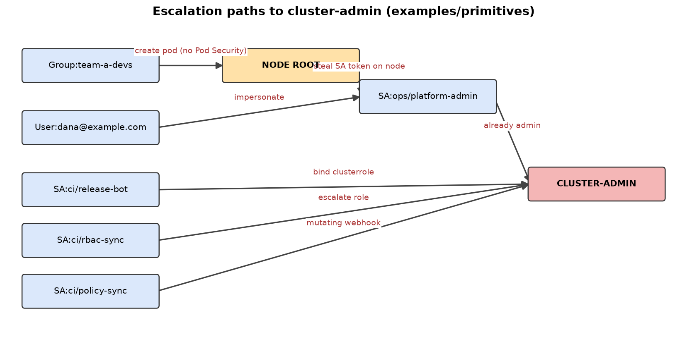
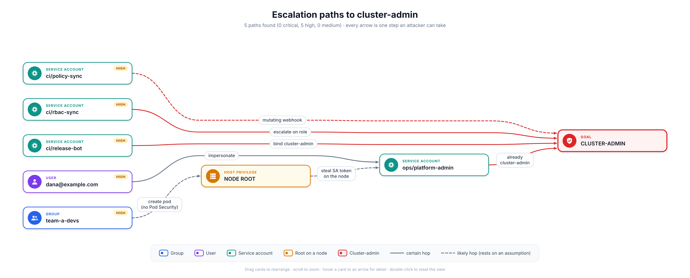
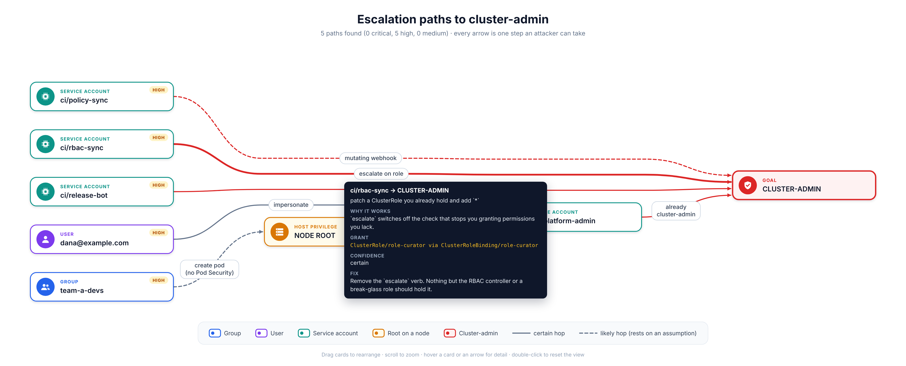
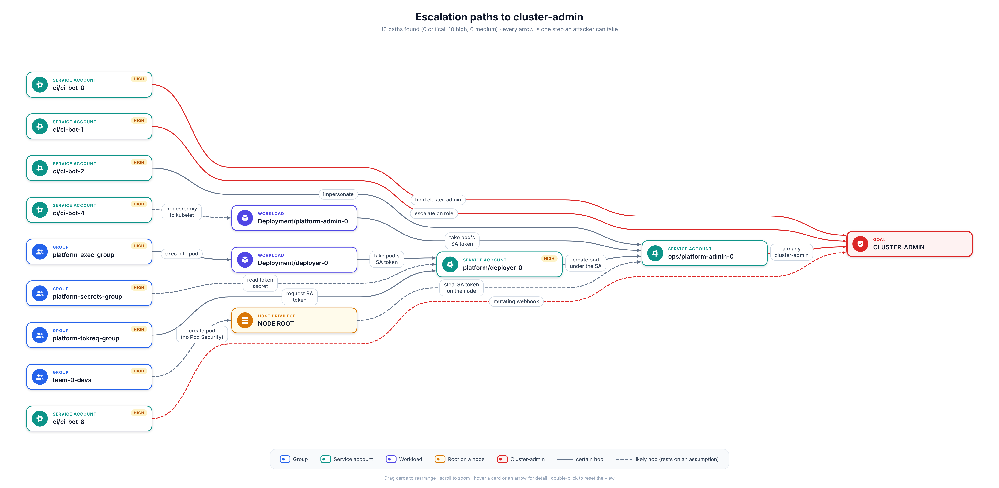

# Sample Output

Example output from the Kubernetes Cluster-Admin Escalation Mapper. Every run below uses the invented fixtures in [`examples/`](examples/), so nothing here describes a real cluster. The full text of each run is stored in [`examples/expected/`](examples/expected/).

Back to the [README](README.md).

## Contents

1. [Text report](#1-text-report)
   - [`keda-style`: a tenant to cluster-admin through an operator](#keda-style)
   - [`nodes-proxy`: a monitoring agent with `nodes/proxy get`](#nodes-proxy)
   - [`primitives`: one identity per escalation primitive](#primitives)
   - [`anonymous-tokens`: open to everyone](#anonymous-tokens)
   - [`clean`: nothing to find](#clean)
2. [JSON output (`--json`)](#2-json-output---json)
3. [Graphviz DOT output (`--dot`)](#3-graphviz-dot-output---dot)
4. [Interactive graph (`--html`)](#4-interactive-graph---html)
5. [Reading the output](#5-reading-the-output)

## 1. Text report

The default output. Each path is listed hop by hop with the grant behind it, followed by the cut list, standing exposures and caveats. Exit code `1` means at least one path was found at or above `--fail-on`; `0` means none.

### `keda-style`

A namespace admin reaches cluster-admin through an operator service account. Modeled on the KEDA write-up (GHSA-637c-6jxx-4rwm); trimmed, not the release manifest.

```bash
python3 scripts/escalation_map.py examples/keda-style --psa-exempt-ns kube-system
```

```text
Parsed 3 ClusterRoles, 1 Roles, 2 ClusterRoleBindings, 2 RoleBindings, 5 ServiceAccounts, 2 workloads, 3 namespaces.
Cluster-admin equivalent identities (1): SA:kube-system/platform-bot
  - SA:kube-system/platform-bot runs Deployment/platform-bot: popping that pod is cluster-admin

[HIGH] PATH 1: Group:tenant-a-devs -> cluster-admin, 2 hops (includes a heuristic hop, verify it)
  1. Group:tenant-a-devs -> SA:keda/keda-operator  [heuristic]
     write custom resources (keda.sh) that operator keda/keda-operator reconciles
     why: Heuristic: the operator acts on these objects with its own wider permissions. Real cases exist (KEDA GHSA-637c-6jxx-4rwm: a namespace tenant made the operator send its token to a tenant-controlled endpoint).
     grant: custom resource write access
  2. SA:keda/keda-operator -> SA:kube-system/platform-bot
     run a pod as kube-system/platform-bot (jobs in kube-system)
     why: Set serviceAccountName: platform-bot in the pod spec; the token is mounted into your container.
     grant: ClusterRole/keda-operator via ClusterRoleBinding/keda-operator
  3. SA:kube-system/platform-bot -> CLUSTER-ADMIN
     already holds `*` on `*` cluster-wide
     why: Cluster-admin equivalent.
     grant: ClusterRole/cluster-admin via ClusterRoleBinding/platform-bot-admin
  Fix: Check that the operator rejects references to tenant-controlled endpoints and uses a namespaced identity per tenant. Limit who can create the operator's custom resources to a dedicated role.

[HIGH] PATH 2: SA:keda/keda-operator -> cluster-admin, 1 hop
  Pods running as it: Deployment/keda-operator
  1. SA:keda/keda-operator -> SA:kube-system/platform-bot
     run a pod as kube-system/platform-bot (jobs in kube-system)
     why: Set serviceAccountName: platform-bot in the pod spec; the token is mounted into your container.
     grant: ClusterRole/keda-operator via ClusterRoleBinding/keda-operator
  2. SA:kube-system/platform-bot -> CLUSTER-ADMIN
     already holds `*` on `*` cluster-wide
     why: Cluster-admin equivalent.
     grant: ClusterRole/cluster-admin via ClusterRoleBinding/platform-bot-admin
  Fix: Drop create/patch on pods and workload controllers from this role, or confine the namespace with Pod Security `restricted` and deploy through a pipeline identity instead.

Smallest set of changes (greedy cover, most paths first):
  1. ClusterRole/keda-operator via ClusterRoleBinding/keda-operator  [POD_CREATE] removes 2 of 2 path(s)
     Drop create/patch on pods and workload controllers from this role, or confine the namespace with Pod Security `restricted` and deploy through a pipeline identity instead.

Standing exposures (no complete path by themselves):
  - SA:keda/keda-operator: write validatingwebhookconfigurations. Can rewrite or disable the cluster's policy-engine webhooks, which removes guardrails that stop other hops.
  - SA:keda/keda-operator: write apiservices. Can redirect an aggregated API (for example metrics) to a server the attacker runs.

Caveats:
  - Not modelled: webhook or policy-engine decisions, network reachability to the kubelet, cloud IAM mappings, and anything outside the files given.

Summary: 2 distinct path(s); 0 critical, 2 high, 0 medium
```

Exit code `1`. The `[heuristic]` tag marks the operator confused-deputy rule: verify that hop by hand.

### `nodes-proxy`

A monitoring agent with `get` on `nodes/proxy`, based on the 2026 research showing that this reaches the kubelet exec endpoint through a WebSocket handshake.

```bash
python3 scripts/escalation_map.py examples/nodes-proxy
```

```text
Parsed 2 ClusterRoles, 0 Roles, 2 ClusterRoleBindings, 0 RoleBindings, 4 ServiceAccounts, 2 workloads, 2 namespaces.
Cluster-admin equivalent identities (1): SA:kube-system/network-installer
  - SA:kube-system/network-installer runs DaemonSet/network-installer: popping that pod is cluster-admin

[HIGH] PATH 1: SA:monitoring/metrics-agent -> cluster-admin, 2 hops
  Pods running as it: DaemonSet/node-exporter
  1. SA:monitoring/metrics-agent -> WL:kube-system/DaemonSet/network-installer  [likely]
     exec in DaemonSet/network-installer through the kubelet
     why: nodes/proxy reaches the kubelet API; its exec endpoint authorizes the WebSocket handshake as a plain `get`.
     grant: ClusterRole/metrics-agent via ClusterRoleBinding/metrics-agent
  2. WL:kube-system/DaemonSet/network-installer -> SA:kube-system/network-installer
     take the ServiceAccount token mounted in DaemonSet/network-installer
     why: Anyone running code in that pod can read /var/run/secrets/kubernetes.io/serviceaccount/token and act as kube-system/network-installer.
     grant: DaemonSet kube-system/network-installer
  3. SA:kube-system/network-installer -> CLUSTER-ADMIN
     already holds `*` on `*` cluster-wide
     why: Cluster-admin equivalent.
     grant: ClusterRole/cluster-admin via ClusterRoleBinding/cni-admin
  Fix: Remove nodes/proxy. Monitoring agents should use the nodes/metrics, nodes/stats and nodes/log subresources (fine-grained kubelet authorization, GA in Kubernetes 1.36), and port 10250 should not be reachable from pods.

Smallest set of changes (greedy cover, most paths first):
  1. ClusterRole/metrics-agent via ClusterRoleBinding/metrics-agent  [NODES_PROXY] removes 1 of 1 path(s)
     Remove nodes/proxy. Monitoring agents should use the nodes/metrics, nodes/stats and nodes/log subresources (fine-grained kubelet authorization, GA in Kubernetes 1.36), and port 10250 should not be reachable from pods.

Caveats:
  - Not modelled: webhook or policy-engine decisions, network reachability to the kubelet, cloud IAM mappings, and anything outside the files given.

Summary: 1 distinct path(s); 0 critical, 1 high, 0 medium
```

Exit code `1`. The `[likely]` tag means the hop assumes the kubelet is reachable from pods, which the tool cannot see in the input.

### `primitives`

Five identities, each holding one primitive (bind, escalate, impersonate, mutating webhook, pod-create in a namespace without Pod Security labels). The fixture also holds a CSR approver reported as an exposure, a restricted namespace as a control, and an aggregated role that leaks secrets.

```bash
python3 scripts/escalation_map.py examples/primitives
```

```text
Parsed 7 ClusterRoles, 2 Roles, 6 ClusterRoleBindings, 2 RoleBindings, 11 ServiceAccounts, 1 workloads, 5 namespaces.
Cluster-admin equivalent identities (2): SA:ops/platform-admin, User:admin@example.com
  - SA:ops/platform-admin runs Deployment/platform-admin: popping that pod is cluster-admin

[HIGH] PATH 1: Group:team-a-devs -> cluster-admin, 2 hops
  1. Group:team-a-devs -> root on a node  [likely]
     schedule a host-level pod in team-a (deployments)
     why: Namespace team-a carries no Pod Security enforce label; privileged, hostPID or a hostPath mount of / is accepted, which is root on the node.
     grant: Role/deployer via RoleBinding/team-a/deployer
  2. root on a node -> SA:ops/platform-admin  [likely]
     read the projected token of ops/platform-admin
     why: Root on a node can read every projected ServiceAccount token of pods on that node, and a pod author can pick the node.
     grant: node root
  3. SA:ops/platform-admin -> CLUSTER-ADMIN
     already holds `*` on `*` cluster-wide
     why: Cluster-admin equivalent.
     grant: ClusterRole/cluster-admin via ClusterRoleBinding/platform-admin
  Fix: Drop create/patch on pods and workload controllers from this role, or confine the namespace with Pod Security `restricted` and deploy through a pipeline identity instead.

[HIGH] PATH 2: SA:ci/policy-sync -> cluster-admin, 1 hop
  1. SA:ci/policy-sync -> CLUSTER-ADMIN  [likely]
     register a mutating webhook that rewrites every pod and sees every object
     why: The webhook can inject host-level containers into pods created by anyone, including controllers running as cluster-admin.
     grant: ClusterRole/policy-manager via ClusterRoleBinding/policy-manager
  Fix: Remove write access to mutatingwebhookconfigurations. Only the controller that owns the webhook should patch it, and only its own configuration by name.

[HIGH] PATH 3: SA:ci/rbac-sync -> cluster-admin, 1 hop
  1. SA:ci/rbac-sync -> CLUSTER-ADMIN
     patch a ClusterRole you already hold and add `*`
     why: `escalate` switches off the check that stops you granting permissions you lack.
     grant: ClusterRole/role-curator via ClusterRoleBinding/role-curator
  Fix: Remove the `escalate` verb. Nothing but the RBAC controller or a break-glass role should hold it.

[HIGH] PATH 4: SA:ci/release-bot -> cluster-admin, 1 hop
  1. SA:ci/release-bot -> CLUSTER-ADMIN
     bind cluster-admin to yourself with a new ClusterRoleBinding
     why: `bind` lets you reference a role you do not hold; create on clusterrolebindings completes it.
     grant: ClusterRole/release-manager via ClusterRoleBinding/release-manager
  Fix: Remove the `bind` verb on roles/clusterroles, or pin it with resourceNames to the exact low-privilege roles that may be granted.

[HIGH] PATH 5: User:dana@example.com -> cluster-admin, 1 hop
  1. User:dana@example.com -> SA:ops/platform-admin
     impersonate SA:ops/platform-admin
     why: Send Impersonate-User and the API server authorizes you as that identity.
     grant: ClusterRole/support-proxy via ClusterRoleBinding/support-proxy
  2. SA:ops/platform-admin -> CLUSTER-ADMIN
     already holds `*` on `*` cluster-wide
     why: Cluster-admin equivalent.
     grant: ClusterRole/cluster-admin via ClusterRoleBinding/platform-admin
  Fix: Remove `impersonate`, or pin it with resourceNames to the single user or group a proxy really needs.

Smallest set of changes (greedy cover, most paths first):
  1. Role/deployer via RoleBinding/team-a/deployer  [POD_CREATE] removes 1 of 5 path(s)
     Drop create/patch on pods and workload controllers from this role, or confine the namespace with Pod Security `restricted` and deploy through a pipeline identity instead.
  2. ClusterRole/role-curator via ClusterRoleBinding/role-curator  [ESCALATE] removes 1 of 5 path(s)
     Remove the `escalate` verb. Nothing but the RBAC controller or a break-glass role should hold it.
  3. ClusterRole/support-proxy via ClusterRoleBinding/support-proxy  [IMPERSONATE] removes 1 of 5 path(s)
     Remove `impersonate`, or pin it with resourceNames to the single user or group a proxy really needs.
  4. ClusterRole/policy-manager via ClusterRoleBinding/policy-manager  [WEBHOOK] removes 1 of 5 path(s)
     Remove write access to mutatingwebhookconfigurations. Only the controller that owns the webhook should patch it, and only its own configuration by name.
  5. ClusterRole/release-manager via ClusterRoleBinding/release-manager  [BIND] removes 1 of 5 path(s)
     Remove the `bind` verb on roles/clusterroles, or pin it with resourceNames to the exact low-privilege roles that may be granted.

Standing exposures (no complete path by themselves):
  - SA:ci/cert-bot: create + approve client CSRs (kube-apiserver-client signer). Can mint and approve arbitrary client certificates. On Kubernetes 1.22+ the API server itself rejects O=system:masters on this signer, so it is not a direct path to cluster-admin, but it still lets the holder become any other user.
  - SA:ci/policy-sync: write validatingwebhookconfigurations. Can rewrite or disable the cluster's policy-engine webhooks, which removes guardrails that stop other hops.
  - ClusterRole/team-extras: aggregated into edit: read secrets. Every holder of the aggregated built-in role silently inherits this, in every namespace where the role is bound.

Caveats:
  - Not modelled: webhook or policy-engine decisions, network reachability to the kubelet, cloud IAM mappings, and anything outside the files given.

Summary: 5 distinct path(s); 0 critical, 5 high, 0 medium
```

Exit code `1`. The identity in the restricted namespace has no path. CSR create plus approve is an exposure, not a path, because Kubernetes 1.22 and later reject `O=system:masters` on the kube-apiserver-client signer. The aggregated-role exposure is the kind of thing a per-role review does not show: every holder of `edit` inherits secret access without anyone editing a binding.

The diagram for this fixture is [Figure 2](#figure-2-escalation-paths-to-cluster-admin) below.

### `anonymous-tokens`

`system:unauthenticated` can read secrets in a namespace that holds a token secret for a cluster-admin service account, and `system:authenticated` can request tokens there.

```bash
python3 scripts/escalation_map.py examples/anonymous-tokens
```

```text
Parsed 3 ClusterRoles, 1 Roles, 1 ClusterRoleBindings, 3 RoleBindings, 4 ServiceAccounts, 0 workloads, 2 namespaces.
Cluster-admin equivalent identities (1): SA:legacy/deploy

[CRITICAL] PATH 1: anyone without credentials (system:unauthenticated) -> cluster-admin, 1 hop
  1. Group:system:unauthenticated -> SA:legacy/deploy
     read secrets in legacy for the token of deploy
     why: get/list on secrets returns values, including kubernetes.io/service-account-token secrets.
     grant: ClusterRole/debug-read via RoleBinding/legacy/debug-read
  2. SA:legacy/deploy -> CLUSTER-ADMIN
     already holds `*` on `*` cluster-wide
     why: Cluster-admin equivalent.
     grant: ClusterRole/cluster-admin via ClusterRoleBinding/legacy-deploy-admin
  Fix: Remove get/list/watch on secrets. List returns every secret value too, so `list` is as bad as `get`. Mount what the workload needs instead.

[CRITICAL] PATH 2: any authenticated identity (system:authenticated) -> cluster-admin, 1 hop
  Same chain also open to: SA:apps/default, SA:apps/web, SA:legacy/default
  1. Group:system:authenticated -> SA:legacy/deploy
     request a token for legacy/deploy
     why: TokenRequest returns a bearer token for that ServiceAccount.
     grant: Role/token-minter via RoleBinding/legacy/token-minter
  2. SA:legacy/deploy -> CLUSTER-ADMIN
     already holds `*` on `*` cluster-wide
     why: Cluster-admin equivalent.
     grant: ClusterRole/cluster-admin via ClusterRoleBinding/legacy-deploy-admin
  Fix: Remove create on serviceaccounts/token, or pin to the single ServiceAccount via resourceNames.

Smallest set of changes (greedy cover, most paths first):
  1. Role/token-minter via RoleBinding/legacy/token-minter  [TOKEN_REQUEST] removes 1 of 2 path(s)
     Remove create on serviceaccounts/token, or pin to the single ServiceAccount via resourceNames.
  2. ClusterRole/debug-read via RoleBinding/legacy/debug-read  [SECRETS_READ] removes 1 of 2 path(s)
     Remove get/list/watch on secrets. List returns every secret value too, so `list` is as bad as `get`. Mount what the workload needs instead.

Caveats:
  - Not modelled: webhook or policy-engine decisions, network reachability to the kubelet, cloud IAM mappings, and anything outside the files given.

Summary: 2 distinct path(s); 2 critical, 0 high, 0 medium
```

Exit code `1`. A path open to a broad group is reported once, with the other affected identities listed under "also open to".

### `clean`

```bash
python3 scripts/escalation_map.py examples/clean; echo "exit $?"
```

```text
Parsed 1 ClusterRoles, 1 Roles, 1 ClusterRoleBindings, 1 RoleBindings, 3 ServiceAccounts, 0 workloads, 1 namespaces.
Cluster-admin equivalent identities (1): Group:platform-admins

No escalation path to cluster-admin found from the identities analysed.
Caveats:
  - Not modelled: webhook or policy-engine decisions, network reachability to the kubelet, cloud IAM mappings, and anything outside the files given.

Summary: 0 distinct path(s); 0 critical, 0 high, 0 medium
exit 0
```

## 2. JSON output (`--json`)

Machine-readable output for dashboards, ticketing or CI steps. The top-level keys are `summary`, `paths` (with every hop), `cut_list`, `exposures` and `notes`.

```bash
python3 scripts/escalation_map.py examples/nodes-proxy --json
```

```json
{
  "summary": {
    "paths": 1,
    "admin_equivalent": [
      "SA:kube-system/network-installer"
    ],
    "by_severity": {
      "critical": 0,
      "high": 1,
      "medium": 0
    },
    "objects": {
      "Namespace": 2,
      "ClusterRole": 2,
      "ClusterRoleBinding": 2,
      "DaemonSet": 2
    }
  },
  "paths": [
    {
      "severity": "high",
      "start": "SA:monitoring/metrics-agent",
      "also_open_to": [],
      "hops": [
        {
          "from": "SA:monitoring/metrics-agent",
          "to": "WL:kube-system/DaemonSet/network-installer",
          "kind": "NODES_PROXY",
          "action": "exec in DaemonSet/network-installer through the kubelet",
          "why": "nodes/proxy reaches the kubelet API; its exec endpoint authorizes the WebSocket handshake as a plain `get`.",
          "grant": "ClusterRole/metrics-agent via ClusterRoleBinding/metrics-agent",
          "confidence": "likely"
        },
        {
          "from": "WL:kube-system/DaemonSet/network-installer",
          "to": "SA:kube-system/network-installer",
          "kind": "WL_SA",
          "action": "take the ServiceAccount token mounted in DaemonSet/network-installer",
          "why": "Anyone running code in that pod can read /var/run/secrets/kubernetes.io/serviceaccount/token and act as kube-system/network-installer.",
          "grant": "DaemonSet kube-system/network-installer",
          "confidence": "certain"
        },
        {
          "from": "SA:kube-system/network-installer",
          "to": "CLUSTER_ADMIN",
          "kind": "ADMIN",
          "action": "already holds `*` on `*` cluster-wide",
          "why": "Cluster-admin equivalent.",
          "grant": "ClusterRole/cluster-admin via ClusterRoleBinding/cni-admin",
          "confidence": "certain"
        }
      ]
    }
  ],
  "cut_list": [
    {
      "kind": "NODES_PROXY",
      "grant": "ClusterRole/metrics-agent via ClusterRoleBinding/metrics-agent",
      "paths_removed": 1,
      "fix": "Remove nodes/proxy. Monitoring agents should use the nodes/metrics, nodes/stats and nodes/log subresources (fine-grained kubelet authorization, GA in Kubernetes 1.36), and port 10250 should not be reachable from pods."
    }
  ],
  "exposures": [],
  "notes": []
}
```

## 3. Graphviz DOT output (`--dot`)

The union of all reported paths as a Graphviz graph. Render it with `dot`:

```bash
python3 scripts/escalation_map.py examples/nodes-proxy --dot | dot -Tsvg > paths.svg
```



```dot
digraph escalation {
  rankdir=LR;
  node [shape=box,fontname="Helvetica"];
  "SA:monitoring/metrics-agent" -> "WL:kube-system/DaemonSet/network-installer" [label="NODES_PROXY"];
  "WL:kube-system/DaemonSet/network-installer" -> "SA:kube-system/network-installer" [label="WL_SA"];
  "SA:kube-system/network-installer" -> "CLUSTER_ADMIN" [label="ADMIN"];
  "CLUSTER_ADMIN" [style=filled,fillcolor="#f4b6b6"];
}
```

## 4. Interactive graph (`--html`)

`--html OUT.html` writes a single self-contained page that draws every reported path with D3. It needs no server and no network. The normal text report still prints.

```bash
python3 scripts/escalation_map.py examples/primitives --html paths.html
```

### Figure 2: Escalation paths to cluster-admin

<p align="center">
  
</p>
<p align="center"><em>Figure 2. Escalation paths for <code>examples/primitives</code>. Each arrow is one hop; every chain ends at cluster-admin (red). Dashed arrows rest on an assumption, such as a namespace with no Pod Security labels. A vector copy is at <a href="assets/escalation-graph-primitives.svg"><code>assets/escalation-graph-primitives.svg</code></a>.</em></p>

### Figure 3: The `--html` page

<p align="center">
  
</p>
<p align="center"><em>Figure 3. The page written by <code>--html</code> for <code>examples/primitives</code>. Start identities are on the left, each column is one more step, and cluster-admin is the last column.</em></p>

### Figure 4: Hovering an arrow

<p align="center">
  
</p>
<p align="center"><em>Figure 4. Hovering an arrow shows what the attacker does, why the grant allows it, the role and binding behind it, the confidence level, and the change that removes the hop.</em></p>

### Figure 5: A larger cluster

<p align="center">
  
</p>
<p align="center"><em>Figure 5. A larger invented cluster: 10 paths, 15 identities and workloads, and up to 4 hops, with mixed identity types.</em></p>

The page contains the identity and grant names from your input, so handle it the way you would handle the text report.

## 5. Reading the output

- **Severity.** CRITICAL means the chain starts at anyone without credentials, any authenticated identity, or any service account. HIGH means one specific identity.
- **Each hop** shows `from -> to`, the action in plain words, why the grant allows it, and which role and binding supplies it.
- **`[likely]`** marks a hop that depends on a stated assumption.
- **`[heuristic]`** marks the operator confused-deputy rule.
- **Standing exposures** are dangerous grants that do not complete a path in the data given.
- **Caveats** list what was not modelled, so a clean result is not presented as proof.
