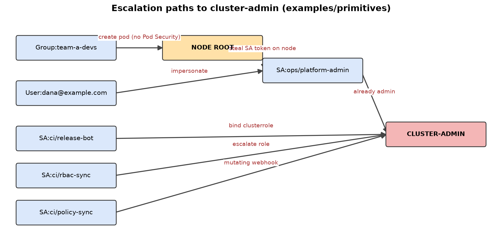
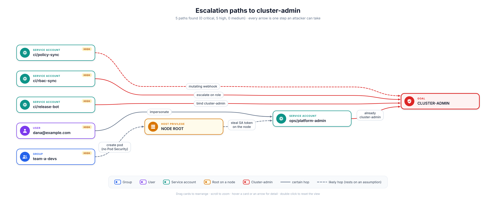
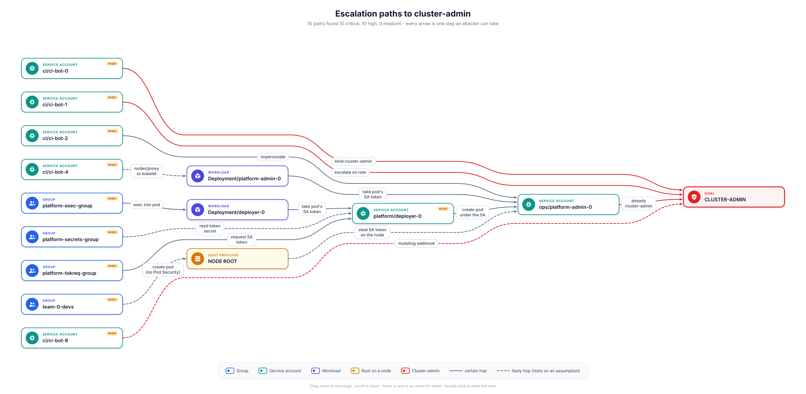
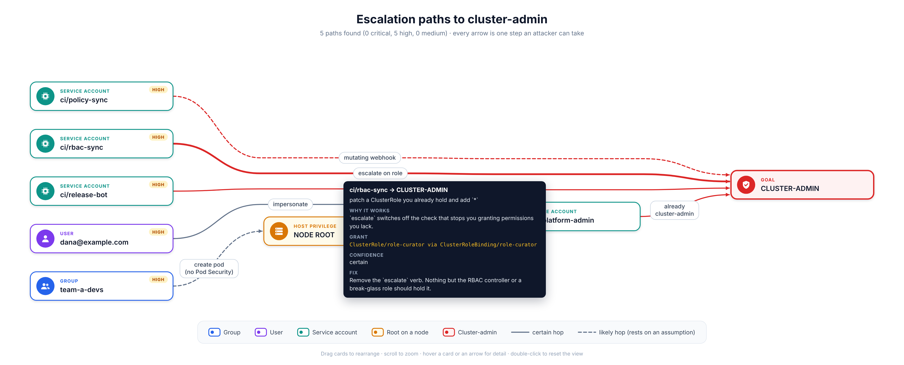

<div align="center">

# Test Report

**Kubernetes Cluster-Admin Escalation Mapper**

Live-cluster validation, bundled fixtures, and the interactive HTML graph

</div>

---

## Contents

1. [Summary and scope](#1-summary-and-scope)
2. [Test environment](#2-test-environment)
3. [Methodology](#3-methodology)
4. [Results summary](#4-results-summary)
5. [Seeded escalation paths](#5-seeded-escalation-paths)
6. [Negative controls](#6-negative-controls)
7. [Bundled fixture results](#7-bundled-fixture-results)
8. [HTML graph rendering](#8-html-graph-rendering)
9. [Bugs found and fixed](#9-bugs-found-and-fixed)
10. [Limitations](#10-limitations)
11. [Reproducing these tests](#11-reproducing-these-tests)

---

## 1. Summary and scope

The mapper reads Kubernetes RBAC and workload manifests and reports every chain of grants an identity could use to become cluster-admin. This report covers three things:

- **Live validation.** Does the mapper find known escalation paths on a real cluster, and stay quiet about accounts that are supposed to be safe?
- **Bundled fixtures.** Do the five invented fixtures in `examples/` still produce their saved expected output?
- **HTML graph.** Does `--html` produce a readable, overlap-free page for every fixture, for a cluster with no paths, and for a graph larger than any fixture?

Out of scope: clusters other than the one listed below, managed-cloud specifics (EKS access entries, GKE, AKS), policy engines (Kyverno, Gatekeeper, ValidatingAdmissionPolicy), and any test that exploits a hop on a cluster we do not own.

## 2. Test environment

| Item | Live cluster run | Fixture and HTML re-runs |
| --- | --- | --- |
| Date | 10 November 2026 | 10 November 2026 |
| Cluster | kind v0.27.0, Kubernetes v1.32.2, local, deleted afterwards | none (files only) |
| Cloud | none, nothing touched AWS or any other provider | none |
| Host | Linux box, Docker | Debian GNU/Linux 13, Linux 6.12, x86_64 |
| Runtime | Python standard library only | Python 3.13.5 |
| Browser for HTML tests | not applicable | Google Chrome 156 (headless) driven by Playwright |
| Tool revision | commit [`3c38653`](https://github.com/ritvikindupuri/k8s-cluster-admin-escalation-mapper/commit/3c386534a27d425df6393167de5f595d571171e9) and later | current `main` |

## 3. Methodology

**Live cluster.**

1. Create a local kind cluster, with no cloud account involved.
2. Take a baseline: dump a stock control plane and confirm the mapper reports no paths from non-system identities.
3. Seed ten escalation primitives, each owned by its own identity, plus four accounts that should stay clean (negative controls).
4. Export a real `kubectl get ... -o yaml` dump of RBAC and workloads, plus a Secret list trimmed to metadata only (names, types, namespaces, ServiceAccount annotation; no values).
5. Run the mapper on that dump and compare its paths with what was seeded.
6. Where it was safe to do so on a throwaway cluster, check the hop by hand, with `kubectl auth can-i`, a token-only client, or the actual action. Some hops (a real `pods/exec`, a registered webhook, kubelet reachability) were detected from the dump but not exploited; the tables say which.
7. Delete the cluster.

**Fixtures.** Run each of the five commands and `diff` the output against `examples/expected/`. Check the exit code.

**HTML graph.** Generate a page with `--html` for each fixture, a larger invented cluster (`examples/synthetic-large/`) and a 42-card hand-built stress graph. Load each in headless Chrome from `file://`, wait for layout to finish, then run a built-in check that fails if any card overlaps another card, any label overlaps a card or another label, or any arrow runs through a card it does not start or end at. Then look at the rendered image.

## 4. Results summary

| Measure | Result |
| --- | --- |
| Seeded escalation paths found | **10 of 10** |
| False positives on negative controls | **0** |
| Time to parse a full dump and analyse it | **about 80 ms** |
| Bundled fixtures matching expected output | **5 of 5** |
| HTML pages rendered with zero overlaps | **7 of 7** (5 fixtures, 1 larger cluster, 1 stress graph) |
| Bugs found by the live run | 5, all fixed |

A baseline dump of a stock kind control plane reported **0** paths from non-system identities. Built-in `kube-system` controller ServiceAccounts are not used as starting points; they can still appear as intermediate hops. Pass `--include-system` to list them. The `aws-auth` hop stays off unless the dump looks like EKS, or you pass `--eks`.

## 5. Seeded escalation paths

| # | Identity | What was seeded | Mapper | Live check |
| --- | --- | --- | --- | --- |
| 1 | `Group:dev-team` | Create a pod as `SA:dev/deploy-bot` (already cluster-admin) | Found | Confirmed: pod-create as that ServiceAccount succeeded |
| 2 | `Group:node-tenants` | Privileged or host-level pod in an unlabeled namespace, then steal a token on the node | Found | Confirmed: pod-create in the unlabeled namespace was allowed |
| 3 | `SA:ops/rbac-manager` | `bind` cluster-admin onto itself | Found | Confirmed with a token-only client and `kubectl auth can-i` |
| 4 | `SA:ops/impersonator` | Impersonate a cluster-admin identity | Found | The mapped path impersonates `SA:dev/deploy-bot`. A separate live `--as-group=system:masters` check also succeeded |
| 5 | `SA:iam/role-editor` | `escalate` on ClusterRoles | Found | Confirmed with a token-only client and `kubectl auth can-i` |
| 6 | `SA:audit/secret-reader` | List secrets, including a token Secret for `SA:kube-system/ci-admin` | Found | Confirmed: token theft succeeded |
| 7 | `Group:tenant-a` | Operator confused deputy (heuristic) into `widgets-operator`, which can read kube-system secrets | Found, marked `[heuristic]` | Not exploited live |
| 8 | `Group:support` | `pods/exec` into a workload running as cluster-admin | Found | Detected from the dump; not exec'd |
| 9 | `SA:monitoring/scraper` | `nodes/proxy` into that same workload through the kubelet | Found | Detected from the dump; kubelet reachability not proven |
| 10 | `Group:webhook-admins` | Write access to mutating webhooks | Found | Detected from the dump; no webhook was registered |

Paths 1 to 6 have a live check, named in the last column. Paths 7 to 10 were found by the mapper from the dump and not carried out.

`SA:pki/csr-bot` can create and approve client CSRs. It is reported as a **standing exposure, not a path**: on Kubernetes 1.22 and later the API server rejects `O=system:masters` on the `kubernetes.io/kube-apiserver-client` signer, and that rejection was observed on this 1.32.2 cluster.

## 6. Negative controls

These accounts were built to have no route to cluster-admin. The mapper reported none for any of them.

| Identity | Why it should be clean | Mapper result | Live check |
| --- | --- | --- | --- |
| `restricted-devs` | Pod-create only inside a Pod Security `restricted` namespace | No path | Stayed denied in `kubectl auth can-i` |
| `auditors` | Can list secrets, but no token Secrets were in the trimmed list | No path | Not applicable (no token to steal) |
| `viewer` | Read-only `view` role | No path | Stayed denied in `kubectl auth can-i` |
| `cm-editor` | Role pinned with `resourceNames` to one ConfigMap | No path | Not applicable |

## 7. Bundled fixture results

The five examples under `examples/` are invented, inert YAML. Do not apply them to a cluster. Each was re-run on 10 November 2026 and its output compared with `examples/expected/`.

| Fixture | Command | Result | Output matches | Exit |
| --- | --- | --- | --- | --- |
| `keda-style` | `python3 scripts/escalation_map.py examples/keda-style --psa-exempt-ns kube-system` | 2 high paths: `Group:tenant-a-devs` reaches cluster-admin through the operator (heuristic), and the operator can create a pod as `SA:kube-system/platform-bot` | Yes | 1 |
| `nodes-proxy` | `python3 scripts/escalation_map.py examples/nodes-proxy` | 1 high path: `SA:monitoring/metrics-agent` reaches cluster-admin through `nodes/proxy` into a privileged DaemonSet | Yes | 1 |
| `primitives` | `python3 scripts/escalation_map.py examples/primitives` | 5 high paths (pod-create, webhook, escalate, bind, impersonate). `SA:ci/cert-bot` is a CSR exposure, not a path. The restricted-namespace identity has no path | Yes | 1 |
| `anonymous-tokens` | `python3 scripts/escalation_map.py examples/anonymous-tokens` | 2 critical paths: `system:unauthenticated` via secret read, `system:authenticated` via TokenRequest | Yes | 1 |
| `clean` | `python3 scripts/escalation_map.py examples/clean` | No paths | Yes | 0 |

Exit code `1` means the run found a path at or above `--fail-on`. It is the expected result for the first four rows.

<p align="center">
  
</p>

<p align="center"><sub><b>Figure 1.</b> The five paths the mapper reports for the <code>primitives</code> fixture. Each arrow is one step an attacker could take, every chain ends at cluster-admin (red), and dashed arrows rest on an assumption such as a namespace with no Pod Security labels.</sub></p>

## 8. HTML graph rendering

`--html OUT.html` writes one self-contained page (D3 inlined, no network). `tests/render_check.py` renders each page in headless Chrome and runs the overlap check described in the methodology.

| Input | Cards | Result | Notes |
| --- | --- | --- | --- |
| `examples/keda-style` | 4 | 0 overlaps | Straight four-column chain, heuristic hop drawn dotted |
| `examples/nodes-proxy` | 4 | 0 overlaps | Workload card type, long names shortened with a tooltip |
| `examples/primitives` | 8 | 0 overlaps | Five start identities, one hop skipping a column |
| `examples/anonymous-tokens` | 4 | 0 overlaps | Two critical starts converging on one service account |
| `examples/clean` | 0 | Renders the "no escalation path found" page | Zero-path case |
| `examples/synthetic-large` | 15 | 0 overlaps | Larger invented cluster, up to four hops |
| 42-card stress graph (hand-built, in `tests/render_check.py`) | 42 | 0 overlaps | Dense: some arrow labels are hidden by design and the footer says how many |

<p align="center">
  
</p>

<p align="center"><sub><b>Figure 2.</b> The <code>--html</code> page for the <code>primitives</code> fixture, rendered by headless Chrome.</sub></p>

<p align="center">
  
</p>

<p align="center"><sub><b>Figure 3.</b> The same page for <code>examples/synthetic-large</code>: ten paths, five columns, arrows routed through the gaps between cards.</sub></p>

<p align="center">
  
</p>

<p align="center"><sub><b>Figure 4.</b> Hovering an arrow shows the grant behind the hop, why it works, how confident the tool is, and the one change that removes it.</sub></p>

## 9. Bugs found and fixed

The live run found five defects. All were fixed in commit [`3c38653`](https://github.com/ritvikindupuri/k8s-cluster-admin-escalation-mapper/commit/3c386534a27d425df6393167de5f595d571171e9).

| # | Bug | Effect | Fix |
| --- | --- | --- | --- |
| 1 | The YAML loader rejected `kubectl` `kind: List` output, where sequence items sit at the same column as the parent key | The tool could not read a real dump. The bundled fixtures used the other indentation, which hid it | Parser accepts both indentation styles |
| 2 | Built-in `kube-system` controller ServiceAccounts were reported as starting points | Noise on every real cluster | Skipped as starts unless `--include-system`; still allowed as intermediate hops |
| 3 | The `aws-auth` hop was always on | A hop that does not exist on non-EKS clusters | Off unless the dump looks like EKS or `--eks` is passed |
| 4 | Create and approve of `kube-apiserver-client` CSRs was reported as a path to cluster-admin | A false path: Kubernetes 1.22+ rejects `O=system:masters` on that signer | Reported as a standing exposure instead |
| 5 | Given a trimmed, metadata-only Secret list, the tool invented token targets | Paths to ServiceAccounts that had no token in the input | Only token Secrets actually present in the input are used |

## 10. Limitations

- **One live cluster.** The live run was a single local kind cluster on Kubernetes 1.32.2. Behaviour on other versions, managed services and unusual authorizers has not been tested.
- **Not every hop was exploited.** Paths 7 to 10 in section 5 were found from the dump and not carried out. The mapper shows what RBAC permits, not that a hop works.
- **Policy engines are not evaluated.** Kyverno, Gatekeeper and ValidatingAdmissionPolicy may already block a hop. The tool prints a note when it sees their objects.
- **Not modelled:** kubelet reachability, whether the control plane is schedulable, cloud IAM, and in-cluster authenticators other than RBAC.
- **Shortest path, not all paths.** A second route through different grants can sit behind the one shown. Fix, rerun, repeat.
- **The 80 ms figure** is the tool's parse-and-analyse time on one small cluster dump, not a benchmark of large clusters.
- **HTML checks are automated plus a visual look.** The overlap check covers cards, labels and arrows through cards. Arrows crossing each other is normal in a layered graph and is not counted. It was tested in Chrome only. In very dense graphs some labels are hidden and must be read by hovering.
- **The 42-card graph is hand-built**, not taken from a real cluster.

## 11. Reproducing these tests

**Fixtures.** `diff` is silent on a match. The first four commands exit `1` because they found paths; that is expected and does not mean the diff failed.

```bash
python3 scripts/escalation_map.py examples/keda-style --psa-exempt-ns kube-system | diff -u examples/expected/keda-style.txt -
python3 scripts/escalation_map.py examples/nodes-proxy | diff -u examples/expected/nodes-proxy.txt -
python3 scripts/escalation_map.py examples/primitives | diff -u examples/expected/primitives.txt -
python3 scripts/escalation_map.py examples/anonymous-tokens | diff -u examples/expected/anonymous-tokens.txt -
python3 scripts/escalation_map.py examples/clean | diff -u examples/expected/clean.txt -
```

**HTML graph.** Needs Playwright and a Chrome or Chromium:

```bash
pip install playwright && playwright install chromium     # or: export CHROME=/usr/bin/google-chrome
python3 tests/render_check.py --shots /tmp/shots           # exit 0 and "ok" on every line when nothing overlaps
python3 scripts/escalation_map.py examples/primitives --html /tmp/primitives.html   # then open it in a browser
```

**Live cluster.** Requires Docker and [kind](https://kind.sigs.k8s.io/). Use a throwaway cluster only.

```bash
kind create cluster --name rbac-test --image kindest/node:v1.32.2
# apply your own seeded RBAC objects, then export:
kubectl get clusterroles,clusterrolebindings,roles,rolebindings,serviceaccounts,namespaces -A -o yaml > rbac.yaml
kubectl get deploy,sts,ds,job,cronjob,pod -A -o yaml > workloads.yaml
python3 scripts/escalation_map.py rbac.yaml workloads.yaml
kind delete cluster --name rbac-test
```
